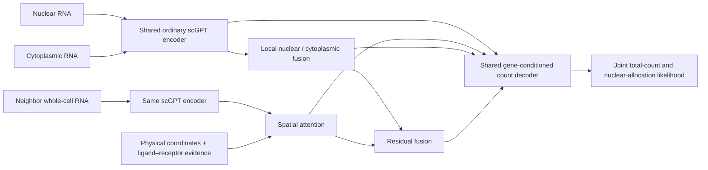

# Spatial Perturb: subcellular and spatial representations (V12)

中文复现文档：[安装与运行](docs/INSTALL.zh.md) · [数据下载链接](docs/DATA.zh.md) · [模型说明](docs/MODEL.zh.md)

V12 combines a cell's nuclear and cytoplasmic RNA with its real spatial neighbors.
It initializes from ordinary **scGPT whole-human**, uses ligand–receptor evidence
as a spatial attention prior, and learns paired raw-count reconstruction.

Readouts: `nucleus`, `cytoplasm`, `local`, `spatial`, `fused`, and `concat`.
Evaluate each view: annotation, region probes and clustering can favor different representations.

| Component | Included |
|---|---|
| Exact model / data / loss / optimizer sources | `src/spatial_pretrain/` |
| Training, inference and preprocessing | `scripts/`, `examples/` |
| Original experiment configurations | `configs/historical/` |
| Portable local configuration generator | `scripts/configure_local_v12.py` |
| Ordinary scGPT download and verification | `scripts/setup_scgpt_assets.sh` |
| Data download catalog | `data_sources/` |
| Curated LR pairs and provenance | `resources/lr_v6/` |
| Dependencies and installation | `requirements.txt`, `docs/INSTALL.zh.md` |

The recorded V12 run completed one epoch on the original 48 Xenium slices
(step 10234). Its fine-tuned checkpoint has **no public download URL in this
release**. The ordinary scGPT initialization assets are downloadable. The later
five-sample Visium HD mixing code is included as an experimental extension;
its presence does not establish completed training or improved region detection.

Start with the [installation guide](docs/INSTALL.zh.md). Core training uses a
64-cell effective batch, deterministic 51-bin inputs and Muon/AdamW parameter
groups; the original model source remains byte-identical for checkpoint auditing.
New inference code relocates assets only after validating their content hashes.

The data catalog distinguishes the 48 actual training samples, five planned HD
samples, additional collected sources and benchmarks. Historical links are
documented as such; some providers require registration or manual file selection.
Raw datasets, caches and large model weights are obtained separately.

Verification for this publication: source-content comparisons, manifest structure,
shell syntax and static review. New environment installation, CPU/GPU tests,
checkpoint relocation and end-to-end execution have not been rerun in this
publishing session. CI is configured to test the portable package after push;
its status must be checked before treating it as passed.

Earlier helper modules are retained where current code or checkpoint source
manifests depend on them. Optional historical research scripts can require
additional dependencies and original data; `requirements.txt` targets V12.
See [third-party notices](THIRD_PARTY_NOTICES.md) for data and upstream terms.
